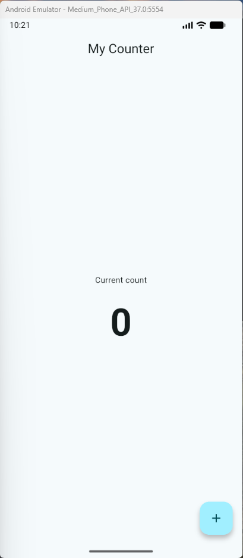

# My Counter App

A simple yet modern Flutter application that implements an interactive counter using Material 3 and declarative widgets.

## Features

- **Material 3 UI**: Modern design featuring a color scheme based on `Colors.cyan`.
- **Interactive Counter**: Real-time counter increments using a floating action button (`FloatingActionButton`).
- **Widget Tests**: Integrated automated tests verifying the initial state and correct increment behavior.

## Screenshot



## Project Structure

- `lib/main.dart`: Entry point of the application (`MyApp` and `MaterialApp` theme configuration).
- `lib/counter_page.dart`: Main screen (`CounterPage`) handling the counter state and Material 3 layout.
- `test/widget_test.dart`: Automated widget tests for counter functionality.

## How to Run the App on an Emulator

1. Install the [Flutter SDK](https://flutter.dev/docs/get-started/install) and make sure `flutter` is available in your terminal.
2. Start Android Studio and open the Device Manager.
3. Create or start an Android emulator, or connect a physical device with USB debugging enabled.
4. Verify the device is detected:
   ```bash
   flutter devices
   ```
5. Run the app from the project root:
   ```bash
   flutter run
   ```

If you want to run a specific device:
```bash
flutter run -d <device_id>
```

To rebuild after code changes:
```bash
flutter hot reload
```

## Counter Page Code

The main logic lives in `lib/counter_page.dart` and manages the value of the counter with `setState()`:

```dart
class _CounterPageState extends State<CounterPage> {
  int counter = 0;

  @override
  Widget build(BuildContext context) {
    return Scaffold(
      appBar: AppBar(
        title: const Text('My Counter'),
        centerTitle: true,
      ),
      body: Center(
        child: Column(
          mainAxisAlignment: MainAxisAlignment.center,
          children: [
            const Text('Current count'),
            const SizedBox(height: 16),
            Text(
              '$counter',
              style: const TextStyle(
                fontSize: 64,
                fontWeight: FontWeight.bold,
              ),
            ),
          ],
        ),
      ),
      floatingActionButton: FloatingActionButton(
        onPressed: () {
          setState(() {
            counter += 1;
          });
        },
        child: const Icon(Icons.add),
      ),
    );
  }
}
```

## Running Tests

To run the automated tests:
```bash
flutter test
```

## License

This project is licensed under the [MIT License](LICENSE).
